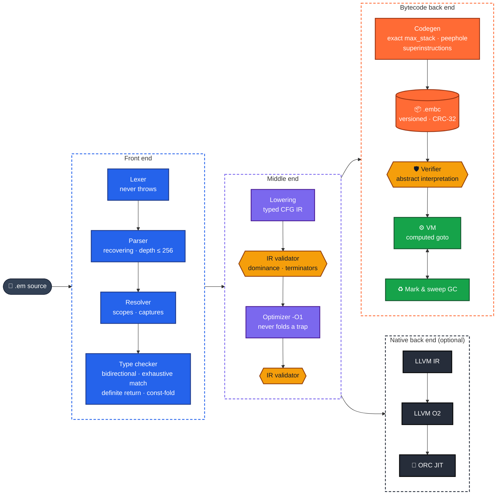
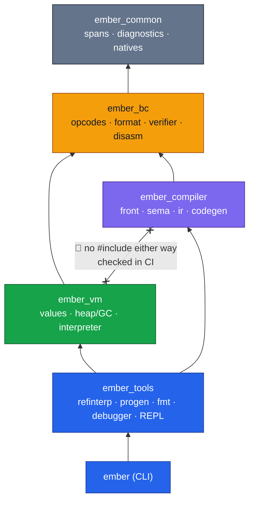
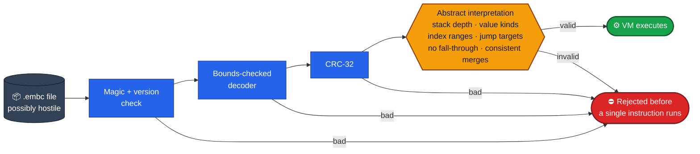
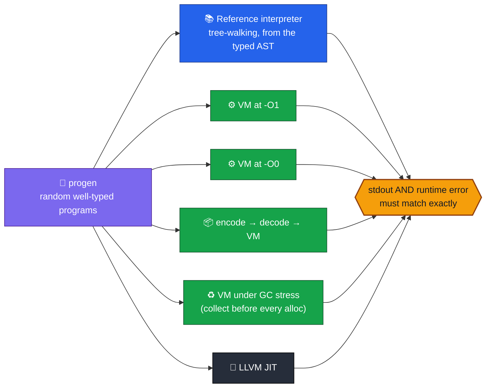
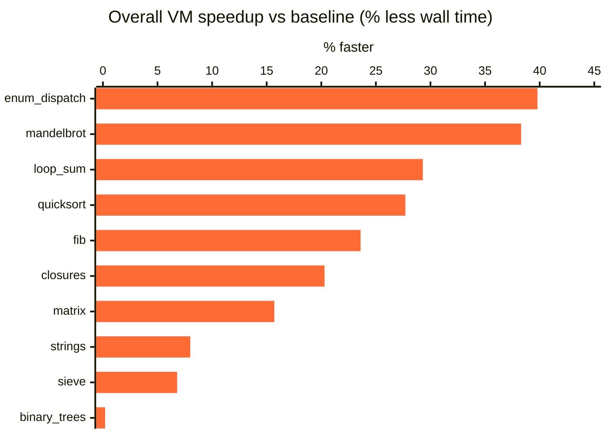
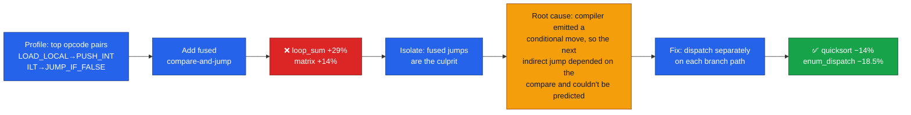
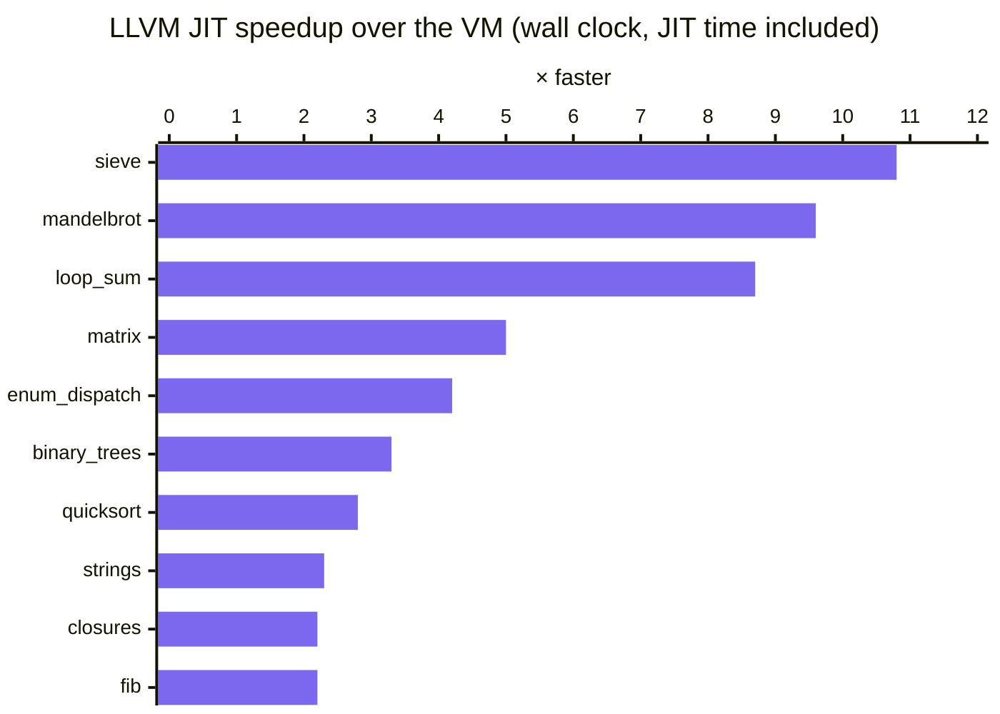

<div align="center">

# 🔥 Ember

### A statically typed language with an optimizing compiler, a verified bytecode format, a garbage-collected VM and an LLVM JIT, all built from scratch in C++20

**Lexer → Parser → Resolver → Type checker → Typed CFG IR → Optimizer → Bytecode → Verifier → VM + GC**
<br/>**…or → LLVM IR → ORC JIT**

<br/>


[](https://github.com/siddhaantxsingh/EMBER-Compiler/actions/workflows/ci.yml)


[**Language**](#-the-language) · [**Pipeline**](#%EF%B8%8F-compiler-pipeline) · [**Trust boundary**](#%EF%B8%8F-the-verifier-is-the-trust-boundary) · [**Testing**](#-testing-five-independent-oracles) · [**Optimization**](#-optimization-measured-not-assumed) · [**LLVM JIT**](#-native-backend-llvm-18-jit) · [**Build**](#-build--run)

</div>

---

## 📌 TL;DR

| | |
|---|---|
| 🗣️ **Language** | Static types with local inference, checked 64-bit ints, structs, **enums with payloads + exhaustive `match`**, first-class closures, arrays, strings, `math`/`strings`/`time` modules |
| 🧠 **Compiler** | Hand-written lexer and recovering parser → resolver with capture analysis → bidirectional type checker → **typed CFG IR with a dominance-checking validator** → trap-preserving optimizer → stack bytecode with superinstructions |
| 🛡️ **Trust boundary** | Versioned, CRC-32-checked `.embc` file → bounds-checked decoder → **abstract-interpretation verifier**. The VM never runs unverified code |
| ⚙️ **Runtime** | Direct-threaded (computed-goto) VM, Lua-style upvalues, **precise mark-and-sweep GC** with an explicit gray stack, heap/step/stack limits, source-level stack traces |
| 🚀 **Native** | Typed IR → LLVM IR → O2 → **ORC JIT**, covering the whole language, with runtime errors that match the VM **byte for byte** |
| 🧪 **Proof** | Differential testing against an **independent reference interpreter** on 20,000 random programs, 5 libFuzzer targets, ASan + UBSan + GC-stress, mutation testing of the backend |
| 🛠️ **Tooling** | Debugger, REPL, formatter, disassembler, IR/AST printers, opcode-pair profiler, rustc-style diagnostics |

---

## ✨ The language

```rust
// Enums with payloads and exhaustive pattern matching.
enum Shape { Circle(Float), Rect(Float, Float), Triangle(Float, Float, Float) }

fn area(s: Shape) -> Float {
    return match s {
        Shape::Circle(r) => 3.141592653589793 * r * r,
        Shape::Rect(w, h) => w * h,
        Shape::Triangle(a, b, c) => heron(a, b, c),
    };
}

// Closures capture variables by reference and outlive their creator.
fn make_account(initial: Int) -> fn(Int) -> Int {
    var balance = initial;
    return fn(delta: Int) -> Int {
        balance += delta;
        return balance;
    };
}
```
<sub>From <a href="examples/shapes.em"><code>examples/shapes.em</code></a> and <a href="examples/closures.em"><code>examples/closures.em</code></a> (Rust syntax highlighting used for display). Full spec: <a href="docs/LANGUAGE_SPEC.md"><code>LANGUAGE_SPEC.md</code></a></sub>

**Diagnostics** point at the exact span:

```text
error[type]: mismatched types in argument 1
  --> wrong_arg_type.em:3:13
  |
3 |     print(f(true));
  |             ^^^^
  = expected: Int
  = found: Bool
```

**Runtime errors** keep source-level stack traces, identical in the VM and the JIT:

```text
RuntimeError: division by zero
  at average (division_by_zero.em:4:14)
  at main (division_by_zero.em:9:11)
```

---

## 🏗️ Compiler pipeline



Each arrow is a data structure handed to the next stage, and **no stage reaches back into an earlier one**. Compiler bugs surface as validator failures and are reported as `internal compiler error` (exit 70), never as a crash.

### Enforced layering



The VM can be linked **without the compiler**: it never sees source, AST or IR. [`scripts/check_layering.sh`](scripts/check_layering.sh) checks every `#include` against this rule in CI.

---

## 🛡️ The verifier is the trust boundary

> **The compiler produces code. The verifier decides whether the VM may run it.**



Instructions are **typed** (`IADD` vs `FADD`, `IJLT` vs float compares), so after verification the VM never inspects tags for arithmetic. It still checks at runtime whatever the verifier can't prove. The decoder is tested against **every truncation, 500 bit flips, garbage with a valid checksum, and forged counts**. Two of the five fuzzers feed raw and mutated bytecode straight into this path. Details: [`BYTECODE.md`](docs/BYTECODE.md) · [ADR-004](docs/adr/004-verifier-trust-boundary.md)

---

## 🧪 Testing: five independent oracles



| Layer | Recorded result |
|---|---|
| ✅ Unit tests (own framework) | **61 / 61** |
| ✅ Golden programs: output, exact diagnostics, runtime traces | **91 / 91** |
| ✅ CLI checks: exit codes, corrupted / truncated / future-version files, debugger + REPL sessions | **31 / 31** |
| 🎲 Differential test, VM vs reference interpreter | **20,000 programs · 0 failures** (11 inconclusive on step limits) |
| 🎲 Differential test under ASan + UBSan | **3,000 programs · 0 failures** |
| 🚀 LLVM JIT vs VM | **68 / 68** supported golden programs identical · **3,000** generated programs, 0 failures |
| 🔀 Optimizer equivalence (-O0 vs -O1) | **72 / 73** identical (the 1 difference is the instruction-budget test, by design) |
| ♻️ Golden suite with `--gc-stress` under ASan + UBSan | **91 / 91** |
| 🐛 libFuzzer: lexer · compiler · compile+run · bytecode · mutated bytecode | **0 crashes** (e.g. 1.87 M bytecode inputs in 600 s) |
| 🧬 Mutation testing of the LLVM backend | 5/7 caught at first → **7/7** after adding `numeric_edges.em` |

### 🐞 Bugs the test infrastructure caught

| Caught by | Bug |
|---|---|
| difftest (first run) | Match bindings in a global initializer had no frame slot → internal compiler error |
| unit test | VM held a reference to a temporary module → crash |
| difftest (20k seeds) | VM and reference interpreter disagreed on the `value too large` error text |
| GCC vs Clang difftest | **The program generator itself** depended on unsequenced `+` operands |
| LeakSanitizer | Reference interpreter leaked reference cycles |
| Clang | Computed goto jumped out of a `std::string`'s scope (GCC accepted it silently) |
| mutation testing | `INT64_MIN % -1` guard and ordered float `!=` in the JIT survived every test → new golden test |

Full matrix: [`TESTING.md`](docs/TESTING.md)

---

## 📈 Optimization: measured, not assumed

**The rule:** profile first, change one thing, run interleaved A/B tests, and keep a change only if it is correct *and* it helps. Run-to-run noise is about ±4%, so anything smaller is reported as neutral.



| Change | Verdict | Evidence |
|---|---|---|
| **Computed-goto dispatch** | ✅ kept: up to **−26%** (`enum_dispatch`), −16 to −22% on calls/loops/floats | `ab-dispatch.json` |
| **Count instructions only when needed** (template on `<kDebug, kCount>`) | ✅ kept: removes a 1–15% tax | budget semantics unchanged |
| **Loop rotation + trace block layout** | ⚖️ kept, but **no speedup claimed**: −8% instructions, wall time within noise | `ab-rotation-layout.json` |
| **Superinstructions** (`LOAD_LOCAL2`, `STORE_LOAD`, fused `IJLT`…) | ❌ **first attempt +29% slower** → diagnosed → ✅ up to **−18.5%** | `ab-superinstructions.json` |

### 🔍 The superinstruction regression



**Current VM numbers** (2-vCPU Xeon, GCC 13 `-O3`, median of 5): `fib(32)` in **0.17 s** · 20 M-iteration loop in **0.71 s** · about **0.5 billion bytecode instructions/s** (1.9 ns each). Allocation-heavy code is bound by `malloc`/`free`, about 50% of `binary_trees` according to callgrind. That's the documented next target. Details: [`OPTIMIZATION.md`](docs/OPTIMIZATION.md) · [`PERFORMANCE.md`](docs/PERFORMANCE.md)

---

## 🚀 Native backend (LLVM 18 JIT)

`ember native file.em` lowers the **same optimized typed IR** to LLVM IR, runs LLVM's O2 pipeline and JIT-compiles it with **ORC LLJIT**. It covers the whole language: checked arithmetic with the VM's traps, strings, arrays, structs, enums, and closures with Lua-style capture semantics. Generated code keeps a small frame table, so **error messages and stack traces match the VM byte for byte.**



<sub>Median of 3, shared 4-vCPU container under load (about 11). All 10 outputs identical to the VM. Raw: <a href="docs/evidence/2026-10-14/bench-native.log"><code>bench-native.log</code></a></sub>

**Limits:** no GC in native mode (an arena freed at exit, capped at 2 GiB), JIT only with no AOT executables, not yet run under ASan. VM-only flags (`--max-steps`, `--max-heap`, `--gc-stress`, `--profile`) exit with status 6.

---

## 🛠️ Build & run

**Requirements:** CMake ≥ 3.20 · GCC 12+ or Clang 15+ · Python 3 · *optional:* `llvm-18-dev` (for `ember native`), `libclang-rt-18-dev` (for clang sanitizer/fuzzer builds)

```bash
cmake -S . -B build -G Ninja -DCMAKE_BUILD_TYPE=Release
cmake --build build
ctest --test-dir build --output-on-failure
```

```bash
ember run examples/shapes.em            # compile + verify + run
ember build prog.em -o prog.embc        # compile to bytecode
ember run prog.embc                     # verify + run a bytecode file
ember native prog.em                    # LLVM JIT
ember native --emit-llvm prog.em        # print the optimized LLVM IR
ember check prog.em                     # type-check only
ember ast | ir | disasm prog.em         # inspect every stage
ember run --profile prog.em             # opcode / pair / function profile
ember debug prog.em                     # breakpoints, stepping, locals
ember repl                              # interactive
ember fmt --write prog.em               # formatter
```

<details>
<summary><b>🧪 Sanitizers, long differential runs, fuzzing, benchmarks</b></summary>

<br/>

```bash
# ASan + UBSan
cmake -S . -B build-asan -DCMAKE_BUILD_TYPE=Debug -DEMBER_ASAN=ON -DEMBER_UBSAN=ON
cmake --build build-asan && ctest --test-dir build-asan --output-on-failure

# 20,000-program differential run
build/tests/difftest --seeds 20000 --start 1000

# Benchmarks (output is checked against bench/expected/ on every run)
python3 bench/run.py --ember build/ember --runs 5
python3 bench/run.py --ember old/ember --ember-b build/ember --runs 7   # interleaved A/B
```

</details>

**CI** ([`ci.yml`](.github/workflows/ci.yml)): GCC debug, GCC release and Clang ASan+UBSan jobs run the layering check, all test suites, an extended differential run, -O0 vs -O1 equivalence, GC stress, the native-backend differential test and a formatter check. Separate jobs run each fuzzer for 60 s and check the benchmark outputs.

---

## 🧭 Design decisions

| ADR | Decision |
|---|---|
| [001](docs/adr/001-language-scope.md) | Language scope for v0.1 |
| [002](docs/adr/002-stack-vm.md) | **Stack VM** over a register VM |
| [003](docs/adr/003-typed-cfg-ir.md) | **Typed CFG IR** between AST and bytecode |
| [004](docs/adr/004-verifier-trust-boundary.md) | The **verifier** is the trust boundary, not the compiler |
| [005](docs/adr/005-mark-sweep-gc.md) | Precise **mark & sweep** GC |
| [006](docs/adr/006-closures-upvalues.md) | By-reference closures with **Lua-style upvalues** |
| [007](docs/adr/007-bytecode-file-format.md) | Versioned, checksummed **bytecode file format** |
| [008](docs/adr/008-error-model.md) | Errors as values in the language; traps for the unrecoverable |
| [009](docs/adr/009-differential-testing.md) | **Differential testing** against a reference interpreter |
| [010](docs/adr/010-repl-by-replay.md) | REPL by replay (no incremental compilation) |

<details>
<summary><b>📚 All documentation</b></summary>

<br/>

[Language spec](docs/LANGUAGE_SPEC.md) · [Architecture](docs/ARCHITECTURE.md) · [Lexer](docs/LEXER.md) · [Parser](docs/PARSER.md) · [Type system](docs/TYPE_SYSTEM.md) · [IR](docs/IR.md) · [Bytecode](docs/BYTECODE.md) · [VM](docs/VM.md) · [GC](docs/GC.md) · [Memory management](docs/MEMORY_MANAGEMENT.md) · [Debugger](docs/DEBUGGER.md) · [Testing](docs/TESTING.md) · [Optimization](docs/OPTIMIZATION.md) · [Performance](docs/PERFORMANCE.md) · [Security](docs/SECURITY.md) · [Audit](docs/AUDIT_2026-10-14.md)

</details>

---

## ⚠️ Scope (v0.1)

**Not yet:** generics · user-defined multi-file modules · catchable exceptions · Unicode-aware strings · incremental compilation · generational/incremental GC · GC and AOT output for the native backend · benchmarks against other languages (Python/Lua) · hour-scale fuzzing campaigns.

**Security:** Ember is **not a hostile-code sandbox.** The verifier and limits stop malformed bytecode and runaway programs from corrupting the VM, but use an OS or container boundary for untrusted code. See [`SECURITY.md`](docs/SECURITY.md).

---

## 📁 Repository layout

```text
EMBER-Compiler/
├── src/
│   ├── front/     🔤  lexer, parser, AST
│   ├── sema/      🧠  resolver, type checker
│   ├── ir/        🔀  typed CFG IR, lowering, validator, optimizer
│   ├── codegen/   🧱  IR → stack bytecode, peephole superinstructions
│   ├── bc/        📦  opcodes, file format, verifier, disassembler
│   ├── vm/        ⚙️  interpreter, values, heap + GC, natives
│   ├── native/    🚀  LLVM backend + runtime
│   ├── tools/     🛠️  reference interpreter, program generator, formatter, debugger, REPL
│   ├── driver/    🚦  pipeline orchestration
│   └── cli/       💻  the `ember` command
├── tests/         ✅  unit · golden programs · CLI · differential tester
├── fuzz/          🐛  libFuzzer targets + seed corpus
├── bench/         📈  10 benchmark programs, runner, recorded results
├── examples/      ✨  sample programs
└── docs/          📖  spec, design docs, 10 ADRs, audits, evidence logs
```

---

<div align="center">

**A language project becomes a systems project when correctness, trust boundaries, memory, performance and failure modes are treated as first-class design problems.**

<br/>

Built by **[Siddhant Singh](https://github.com/siddhaantxsingh)**

</div>
