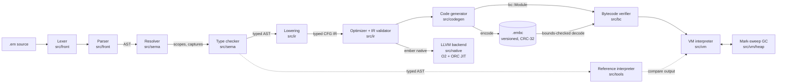

# Ember

A statically typed programming language in C++20: an optimizing compiler, a verified bytecode format, a stack VM with a precise garbage collector, and an optional LLVM JIT backend.

[](https://github.com/siddhaantxsingh/EMBER-Compiler/actions/workflows/ci.yml?query=branch%3Accr-a6e6c567-y4w7k8)

-262D3A?logo=llvm&logoColor=white)

Lexer, parser, type checker, typed CFG IR, optimizer, bytecode, verifier, VM and GC are all written from scratch. The verifier, not the compiler, decides whether the VM may run a bytecode file.

```ember
fn make_counter() -> fn() -> Int {
    var count = 0;
    return fn() -> Int {
        count += 1;
        return count;
    };
}

enum Shape {
    Circle(Float),
    Rect(Float, Float)
}

fn area(s: Shape) -> Float {
    return match s {
        Shape::Circle(r) => 3.14159 * r * r,
        Shape::Rect(w, h) => w * h,
    };
}

fn main() {
    let next = make_counter();
    next();
    print(next());                      // 2
    print(area(Shape::Rect(2.0, 3.0))); // 6.0
}
```

Static types with local inference, checked 64-bit integers, floats, strings, arrays, structs, enums with payloads, exhaustive `match`, and first-class closures that capture by reference. Standard modules: `math`, `strings`, `time`. Full grammar and semantics: [LANGUAGE_SPEC.md](docs/LANGUAGE_SPEC.md).

## Highlights

- **Differential testing against a reference interpreter.** For 20,000 generated, well-typed programs, a separate tree-walking interpreter over the typed AST agreed with the VM at `-O1` and `-O0`, with bytecode decoded from a file, and (every 10th seed) in GC stress mode: 0 failures, 11 inconclusive (instruction or step limit) ([TESTING.md](docs/TESTING.md), [ADR-009](docs/adr/009-differential-testing.md)).
- **LLVM JIT backend that matches the VM exactly.** On 68/68 supported test programs and 3,000 generated programs, `ember native` gave identical stdout, stderr (including stack traces) and exit codes. It ran 2.2x–10.8x faster than the VM on the 10 benchmarks, JIT time included, on a shared machine ([`bench-native.log`](docs/evidence/2026-10-14/bench-native.log)).
- **A bytecode verifier as the trust boundary.** `.embc` files are bounds-checked, CRC-32 checked and abstractly interpreted before any instruction runs. Unit tests feed it every truncation, 500 bit flips and forged counts. 5 libFuzzer targets, including a bytecode mutator, ran 60 s each with no crashes ([`fuzz.log`](docs/evidence/2026-10-14/fuzz.log)).
- **Optimizations kept only when measured.** Computed-goto dispatch and superinstructions made the 10 benchmarks 0–40 % faster than the baseline. The first superinstruction attempt was slower and is documented with its cause and fix ([OPTIMIZATION.md](docs/OPTIMIZATION.md)).
- **Optimization and GC are checked for equivalence.** `-O0` vs `-O1` gave identical output on 72/73 programs; the one difference is the instruction-budget test, where that is the intended behaviour. The golden suite passes 91/91 with `--gc-stress` (collect before every allocation) under ASan+UBSan.
- **The VM never depends on the compiler.** A CI script checks every `#include` against the library layering, so the VM can be linked without any compiler code.

## Architecture



Each stage hands one data structure to the next and never reaches back. The front end (lexer, parser, resolver, type checker) collects all errors in one `Diagnostics` object, and later stages run only on error-free input. Lowering produces a typed control-flow graph with explicit evaluation order and explicit upvalue closing. The IR validator checks terminators, dominance and operand kinds before and after optimization. The code generator emits stack bytecode, with superinstructions chosen from profile data. Whether the module comes straight from the compiler or from a file, the verifier checks stack depths, kinds and jump targets before the VM runs it. The native backend lowers the same optimized IR to LLVM IR instead. The libraries are layered `common <- bc <- vm` and `common <- bc <- compiler`, and `scripts/check_layering.sh` enforces this in CI. Details: [ARCHITECTURE.md](docs/ARCHITECTURE.md).

## Quick start

Requirements: CMake 3.20+, a C++20 compiler (GCC 12+ or Clang 15+), Python 3, Ninja (optional). Optional: `llvm-18-dev` for `ember native`, and `clang` plus `libclang-rt-18-dev` for sanitizer and fuzzer builds.

```bash
git clone https://github.com/siddhaantxsingh/EMBER-Compiler.git
cd EMBER-Compiler
cmake -S . -B build -G Ninja -DCMAKE_BUILD_TYPE=Release
cmake --build build
ctest --test-dir build --output-on-failure
```

Without LLVM 18 the build still works, and `ember native` exits with status 6. Use the CLI:

```bash
./build/ember run examples/shapes.em          # compile and run
./build/ember build examples/shapes.em -o shapes.embc
./build/ember verify shapes.embc              # decode and verify a bytecode file
./build/ember run shapes.embc
./build/ember native examples/shapes.em       # LLVM JIT (needs llvm-18-dev)
./build/ember disasm examples/closures.em     # also: ir, ast, tokens, check
./build/ember run --profile examples/life.em  # opcode and pair counts
./build/ember debug examples/fizzbuzz.em      # interactive debugger
./build/ember repl
./build/ember fmt --check examples/hello.em
```

Diagnostics point at the source, and runtime errors carry a stack trace:

```text
error[type]: mismatched types in argument 1
  --> wrong_arg_type.em:3:13
  |
3 |     print(f(true));
  |             ^^^^
  = expected: Int
  = found: Bool
```

```text
RuntimeError: division by zero
  at average (stats.em:4:14)
  at main (stats.em:9:11)
```

Sanitizer build (clang):

```bash
CC=clang CXX=clang++ cmake -S . -B build-asan -G Ninja \
  -DCMAKE_BUILD_TYPE=RelWithDebInfo -DEMBER_ASAN=ON -DEMBER_UBSAN=ON -DEMBER_LLVM=OFF
cmake --build build-asan
ctest --test-dir build-asan --output-on-failure
```

## Results

### VM (2-vCPU cloud VM, GCC 13.3 `-O3`, median of 5 runs, wall clock including compilation)

| Benchmark | What it does | Median |
|---|---|---:|
| fib | naive `fib(32)`, ≈ 7 M calls | 0.172 s |
| loop_sum | 20 M iterations of `%`, `==`, `+=` | 0.712 s |
| mandelbrot | 400×400 points, ≤ 100 iterations | 0.318 s |
| sieve | sieve of Eratosthenes to 5 M | 1.217 s |
| binary_trees | allocation / GC, depth 16 | 0.315 s |
| quicksort | sort 1 M integers | 0.834 s |

`loop_sum` runs about 0.5 G bytecode instructions per second (≈ 1.9 ns each). All 10 benchmarks: [PERFORMANCE.md](docs/PERFORMANCE.md).

### Optimization work (same machine, interleaved A/B, 7 runs)

| Benchmark | Baseline | Optimized | Change |
|---|---:|---:|---:|
| enum_dispatch | 1.055 s | 0.635 s | −39.8 % |
| mandelbrot | 0.503 s | 0.310 s | −38.3 % |
| loop_sum | 1.003 s | 0.709 s | −29.3 % |
| fib | 0.217 s | 0.166 s | −23.6 % |
| binary_trees | 0.332 s | 0.331 s | −0.2 % (allocation-bound, not improved) |

Baseline is commit `644ad06` (switch dispatch, no superinstructions). Loop rotation and block layout cut executed instructions by about 5 % but gave no measurable speedup, and none is claimed.

### Native backend vs VM (2026-10-14, shared 4-vCPU container at load average ~11, median of 3)

| Program | VM | Native (incl. JIT) | Speedup |
|---|---:|---:|---:|
| sieve | 1.330 s | 0.123 s | 10.8x |
| mandelbrot | 0.488 s | 0.051 s | 9.6x |
| loop_sum | 0.616 s | 0.071 s | 8.7x |
| binary_trees | 0.373 s | 0.114 s | 3.3x |
| fib | 0.170 s | 0.077 s | 2.2x |
| closures | 0.241 s | 0.110 s | 2.2x |

Output was equal on all 10 programs. Full log: [`bench-native.log`](docs/evidence/2026-10-14/bench-native.log). No comparison with Python or Lua was made.

## How correctness is verified

| Layer | Result | Source |
|---|---|---|
| Unit tests (61): lexer, parser, sema, IR validator, optimizer, decoder, verifier, VM checks, GC, formatter | PASS | [`tests/unit/`](tests/unit/) |
| Golden programs (run, compile-error, runtime-error) | 91/91 | [`tests/programs/`](tests/programs/) |
| CLI checks: exit codes, bad bytecode, debugger, REPL, formatter idempotence | 31 PASS | [`tests/cli_tests.py`](tests/cli_tests.py) |
| Differential vs reference interpreter, 20,000 seeds | 0 failures, 11 inconclusive | [TESTING.md](docs/TESTING.md) |
| Native vs VM: test programs / generated programs | 68/68 identical; 3,000 seeds, 0 failures, 1 inconclusive | [`native-difftest-final.log`](docs/evidence/2026-10-14/native-difftest-final.log), [`native-difftest-3000-seeds.log`](docs/evidence/2026-10-14/native-difftest-3000-seeds.log) |
| Backend mutation testing | 5/7 caught, 7/7 after adding `numeric_edges.em` | [`native-mutation.log`](docs/evidence/2026-10-14/native-mutation.log) |
| `-O0` vs `-O1` | 72/73 identical (1 by design) | [`opt-equivalence-O0.log`](docs/evidence/2026-10-14/opt-equivalence-O0.log) |
| GC stress over golden suite under ASan+UBSan | 91/91 | [`final-asan-gcstress.log`](docs/evidence/2026-10-14/final-asan-gcstress.log) |
| libFuzzer: lexer, compile, run, bytecode, mutate_bytecode | 60 s each, no crashes (30k–655k execs) | [`fuzz.log`](docs/evidence/2026-10-14/fuzz.log) |

CI ([`ci.yml`](.github/workflows/ci.yml)) runs 5 jobs on every push: gcc-debug, gcc-release (with LLVM: ctest, 3,000-seed difftest, 300-seed native difftest, `-O0` comparison, formatter check), clang-asan-ubsan (ctest and the GC-stress suite), fuzz-smoke (5 fuzzers x 60 s) and benchmarks-smoke (output check only). All jobs passed in run 38740180634.

## Design decisions

- **Stack VM, not a register VM.** Needs no register allocation or liveness in the code generator and verifier, at the cost of executing more instructions; superinstructions recover part of that ([ADR-002](docs/adr/002-stack-vm.md)).
- **Typed CFG IR with single-assignment temps and mutable locals.** Maps 1:1 to frame slots and is easy to validate (dominance and kinds). Optimizations that need SSA over variables would need a conversion step first ([ADR-003](docs/adr/003-typed-cfg-ir.md)).
- **The verifier is the trust boundary.** It proves stack discipline, operand kinds and index ranges by abstract interpretation; the VM checks the rest at run time. A checksum alone would not stop a crafted file ([ADR-004](docs/adr/004-verifier-trust-boundary.md)).
- **Precise stop-the-world mark-sweep GC.** Simple and testable with a stress mode. It costs about a quarter to a third of the time on allocation-heavy programs ([ADR-005](docs/adr/005-mark-sweep-gc.md), [GC.md](docs/GC.md)).
- **Closures capture by reference through Lua-style upvalues** ([ADR-006](docs/adr/006-closures-upvalues.md)).
- **No catchable exceptions.** Runtime errors stop the program with a stack trace and exit status 3; recoverable failures are modelled with enums. No unwinding to implement, but programs must check before, for example, indexing ([ADR-008](docs/adr/008-error-model.md)).

## Limitations and status

Version 0.1.

- **Native backend:** no garbage collector (an arena freed at exit, 2 GiB cap), JIT only (no AOT executables), not run under ASan, no dedicated fuzzer. VM-only flags (`--max-steps`, `--max-heap`, `--gc-stress`, `--profile`) make it exit with status 6.
- **Language:** no user-defined multi-file modules, generics, catchable exceptions or Unicode-aware string operations.
- **Runtime:** no generational or incremental GC; allocation-heavy code is bound by `malloc`/`free`.
- **Evidence:** benchmarks come from single cloud VMs (the native numbers from a shared, loaded one). Fuzzing was 60 s per target, not hour-scale. Cross-platform builds were not tested.
- **Not a sandbox.** Run untrusted programs inside an OS or container boundary ([SECURITY.md](docs/SECURITY.md)).

Open items and how to run the longer checks: [OWNER_ACTIONS.md](docs/OWNER_ACTIONS.md).

## Repository layout

```text
src/
  front/     lexer, parser, AST
  sema/      resolver, type checker
  ir/        lowering, optimizer, IR validator
  codegen/   bytecode generator, superinstruction peephole
  bc/        opcodes, .embc format, verifier, disassembler
  vm/        interpreter, values, heap and GC
  native/    LLVM backend and its runtime
  tools/     reference interpreter, program generator, formatter, debugger, REPL, profiler
  driver/, cli/, common/
tests/       unit tests, golden programs, CLI tests, difftest
fuzz/        libFuzzer targets, corpus, dictionary
bench/       benchmark programs, expected output, results
scripts/     layering check, native difftest, GC-stress runner, native benchmark
examples/    sample programs
docs/        design docs per stage, ADRs, audit, evidence
```

## Documentation

| Area | Link |
|---|---|
| Language specification | [LANGUAGE_SPEC.md](docs/LANGUAGE_SPEC.md) |
| Architecture | [ARCHITECTURE.md](docs/ARCHITECTURE.md) |
| Front end | [LEXER.md](docs/LEXER.md), [PARSER.md](docs/PARSER.md), [TYPE_SYSTEM.md](docs/TYPE_SYSTEM.md) |
| IR and optimization | [IR.md](docs/IR.md), [OPTIMIZATION.md](docs/OPTIMIZATION.md) |
| Bytecode and VM | [BYTECODE.md](docs/BYTECODE.md), [VM.md](docs/VM.md) |
| Memory | [GC.md](docs/GC.md), [MEMORY_MANAGEMENT.md](docs/MEMORY_MANAGEMENT.md) |
| Tooling | [DEBUGGER.md](docs/DEBUGGER.md) |
| Testing | [TESTING.md](docs/TESTING.md) |
| Performance | [PERFORMANCE.md](docs/PERFORMANCE.md) |
| Security | [SECURITY.md](docs/SECURITY.md) |
| Requirements matrix | [REQUIREMENTS_MATRIX.md](docs/REQUIREMENTS_MATRIX.md) |
| Audits | [AUDIT_2026-10-14.md](docs/AUDIT_2026-10-14.md), [FINAL_AUDIT.md](docs/FINAL_AUDIT.md), [ARCHITECTURE_AUDIT.md](docs/ARCHITECTURE_AUDIT.md) |
| Scorecard | [scorecard.md](docs/scorecard.md) |
| ADRs | [`docs/adr/`](docs/adr/) |

---

Built by [Siddhant Singh](https://github.com/siddhaantxsingh).
