# Architecture

Ember is a statically typed language implemented as a multi-stage compiler
that produces a portable, verified bytecode format, and a separate virtual
machine with a precise garbage collector that executes it.

## Pipeline

```mermaid
flowchart LR
    SRC[source .em] --> LEX[Lexer<br/>src/front/lexer]
    LEX -->|tokens + comments| PAR[Parser<br/>src/front/parser]
    PAR -->|AST| RES[Resolver<br/>src/sema/resolver]
    RES -->|symbols, scopes,<br/>captures| TC[Type checker<br/>src/sema/checker]
    TC -->|typed AST| LOW[Lowering<br/>src/ir/lower]
    LOW -->|IR: CFG + typed temps| VAL1[IR validator]
    VAL1 --> OPT[Optimizer<br/>src/ir/opt]
    OPT --> VAL2[IR validator]
    VAL2 --> CG[Code generator<br/>src/codegen]
    CG -->|bc::Module| VER[Bytecode verifier<br/>src/bc/verify]
    CG -->|encode| FILE[(.embc file<br/>CRC32)]
    FILE -->|decode, bounds-checked| VER
    VER --> VM[VM interpreter<br/>src/vm]
    VM <--> GC[Mark & sweep GC<br/>src/vm/heap]
    TC -.typed AST.-> REF[Reference interpreter<br/>src/tools/refinterp]
    REF -.compare output.- VM
```



Each arrow is a data structure handed to the next stage; no stage reaches
back into an earlier one. Diagnostics are collected by every front-end
stage in one `Diagnostics` object; a stage runs only if the previous one
produced no errors (the parser recovers locally so that one syntax error
does not hide the next).

## Libraries and the dependency rule

| Library | Directories | May depend on |
| --- | --- | --- |
| `ember_common` | `src/common` (source files, spans, diagnostics, kinds, native table, number formatting) | nothing |
| `ember_bc` | `src/bc` (opcodes, module, file format, verifier, disassembler) | common |
| `ember_vm` | `src/vm` (values, heap/GC, interpreter, natives) | bc, common |
| `ember_compiler` | `src/front`, `src/sema`, `src/ir`, `src/codegen`, `src/driver` | bc, common |
| `ember_tools` | `src/tools` (reference interpreter, program generator, formatter, AST printer, debugger, REPL) | everything |
| `ember` | `src/cli` | everything |

The VM never sees source code, the AST or the IR: it can be linked without
the compiler. The compiler never sees the VM. `scripts/check_layering.sh`
checks `#include` lines against this table (run in CI).

## Stage responsibilities

| Stage | Input → output | Guarantees for the next stage | Doc |
| --- | --- | --- | --- |
| Lexer | bytes → tokens, comments | never throws; bad input becomes `Error` tokens + diagnostics | [LEXER.md](LEXER.md) |
| Parser | tokens → AST | bounded nesting (256), every node has a span | [PARSER.md](PARSER.md) |
| Resolver | AST → symbols | every identifier bound; captures computed per function; illegal assignments, `break` outside loops rejected | [TYPE_SYSTEM.md](TYPE_SYSTEM.md) |
| Type checker | AST → typed AST | every expression has a type; exhaustive matches; definite returns; constants folded with runtime semantics | [TYPE_SYSTEM.md](TYPE_SYSTEM.md) |
| Lowering | typed AST → IR | explicit evaluation order, explicit loads/stores, explicit upvalue closing | [IR.md](IR.md) |
| IR validator | IR → ok / bug report | terminators, dominance of definitions, operand kinds, index ranges | [IR.md](IR.md) |
| Optimizer | IR → IR | behaviour preserved exactly, including traps | [OPTIMIZATION.md](OPTIMIZATION.md) |
| Code generator | IR → bytecode | empty operand stack at block boundaries, exact `max_stack`, line tables | [BYTECODE.md](BYTECODE.md) |
| Verifier | bytecode → ok / errors | stack and kind safety, index ranges, no fall-through | [BYTECODE.md](BYTECODE.md) |
| VM | verified bytecode → effects | runtime checks for everything the verifier cannot prove; deterministic errors | [VM.md](VM.md) |
| GC | heap | precise roots, no recursion, limits | [GC.md](GC.md), [MEMORY_MANAGEMENT.md](MEMORY_MANAGEMENT.md) |

## Key design decisions

The ADRs in `docs/adr/` record the decisions and the alternatives:
stack VM over register VM (ADR-002), typed CFG IR (ADR-003), the verifier
as the trust boundary (ADR-004), mark & sweep (ADR-005), by-reference
closures with Lua-style upvalues (ADR-006), the file format (ADR-007),
error handling without exceptions in the language (ADR-008), differential
testing against a reference interpreter (ADR-009), and the replay REPL
(ADR-010).

## Error handling inside the implementation

* User errors in source code: `Diagnostics` (never exceptions).
* Malformed bytecode files: `bc::DecodeError` from the decoder, a list of
  errors from the verifier.
* Program runtime errors: `VM::Error` thrown inside the interpreter and
  converted to a `RunResult` with a stack trace at the `run()` boundary.
* Compiler bugs: `std::logic_error` from lowering/codegen, or IR/bytecode
  validation failures; the driver reports them as
  `internal compiler error` (exit code 70) instead of crashing.

## REPL

The REPL (ADR-010) re-compiles the accumulated declarations and statements
plus the new input and re-runs the whole program, printing only output not
shown before. This keeps the REPL a thin client of the normal pipeline (no
incremental compilation or persistent VM state), at the cost of replaying
side effects and getting slower as a session grows.

## Repository layout

```
src/        implementation (see table above)
tests/      unit tests, golden programs, CLI tests, differential tester
fuzz/       libFuzzer targets, dictionary, seed corpus
bench/      benchmark programs, runner, recorded results
examples/   example programs used in the README
docs/       specification, design documents, ADRs, audit, interview notes
scripts/    layering check
```
